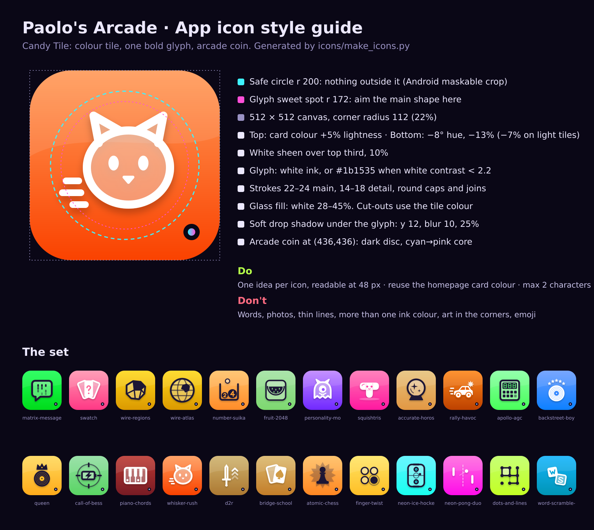

# Paolo's Arcade: app icon style guide

Every app in the arcade uses one icon style, **Candy Tile**: a glossy tile in the app's own colour, one bold glyph and the arcade coin in the corner. The same art is used on the phone home screen, in the browser tab and on the homepage cards.



## The kit

Everything is generated by `icons/make_icons.py`. Nothing is drawn by hand in a design app.

```bash
python3 icons/make_icons.py               # rebuild every icon + style-guide.png
python3 icons/make_icons.py my-new-game   # just one app
```

For each app it writes:

| File | Shape | Used for |
|---|---|---|
| `<slug>/icon.svg` | rounded tile + coin | favicon, `purpose: any` source |
| `<slug>/icon-192.png`, `icon-512.png` | rounded tile + coin | manifest `any` icons |
| `<slug>/icon-maskable-512.png` | full-bleed square, no coin | manifest `maskable` (Android crops it) |
| `<slug>/apple-touch-icon.png` (180) | full-bleed square + coin | iPhone home screen (iOS rounds it) |
| `icons/<slug>.svg` | full-bleed square + coin | homepage card + growth log (CSS rounds it, so the Sharp toggle squares it) |

The homepage picks up `icons/<slug>.svg` automatically from each game's `url`. The `emoji` field in `GAMES` is only a fallback if that file is missing.

## Rules

**Canvas.** 512 × 512 pixels, corner radius 112 (22 %).

**Tile colour.** Start from the app's homepage card `color`, so the card glow and the icon match. The generator builds a vertical gradient from it:
- top: card colour, lightness +5 %
- bottom: hue −8°, lightness −13 % (only −7 % on light tiles, so yellows stay yellow instead of going brown), saturation +5 %
- a white sheen over the top third at 10 %.

Two apps may share a colour (Wire Atlas and Wire Regions do). The glyph tells them apart.

**Ink.** The glyph uses one ink colour: white, or arcade dark `#1b1535` when white has less than 2.2:1 contrast on the tile. The generator decides this automatically, so don't override it.

**Glyph.**
- One idea per icon, the thing you'd point at to explain the app: a cat for Whisker Rush, a pawn in a blast for Atomic Chess.
- Keep everything inside the **safe circle** (radius 200 around the centre). Aim the main shape at radius ~172. Anything outside gets cut off by Android's round masks.
- Main strokes 22–24 px, detail strokes 14–18 px, round caps and joins. Nothing thinner than 5 px.
- Three fills only: solid ink, **glass** (white at 28–45 %, via the `T()` helper) and **cut-outs** in the tile colour (the `a` argument), e.g. the spade on the Bridge card or the digits in Number Suika.
- At most two characters of lettering, drawn as stroke paths, never `<text>` (fonts differ per phone).
- A soft drop shadow sits under the whole glyph (y 12, blur 10, 25 % black). The generator adds it.

**Arcade coin.** A dark disc (r 22) with a cyan→pink core (r 10) at (436, 436), bottom right. It's the arcade's signature on every icon. It is left off the maskable icon, since Android would crop it.

**Check at 48 px.** Render at 48 px and look at it next to the others. If the glyph turns into a blob, drop detail or thicken strokes.

## Don't

- Use emoji, photos, screenshots or gradients inside the glyph.
- Write words or app names. The home screen shows the name underneath.
- Use a second ink colour or the arcade's neon cyan/pink outside the coin.
- Put art in the corners or past the safe circle.
- Use thin hairlines or tiny details that vanish at 48 px.

## Adding a new app

1. Write a glyph function `g_myapp(k, a)` in `make_icons.py`. `k` is the ink and `a` the tile colour for cut-outs. Borrow helpers: `T()` glass, `S()` stroke, `star()`, `spade()`, `record()`.
2. Add `('my-app-slug', '#cardcolour', g_myapp)` to `APPS`, using the same colour as the homepage card.
3. Run `python3 icons/make_icons.py my-app-slug`, then `python3 icons/make_icons.py` once more to refresh `style-guide.png`.
4. Look at `icon-512.png` and a 48 px render. Make sure `sw.js` lists `icon.svg`, the three PNGs and `apple-touch-icon.png`.
5. Desktop-only apps without a manifest go in `NO_PWA`: they get only `icon.svg` and `apple-touch-icon.png`.

When an app's icon changes, bump `VERSION` in its `sw.js` so installed copies pick it up. A phone that already installed the app may keep the old home-screen icon for a while. Removing the app from the home screen and adding it again always shows the new one.
